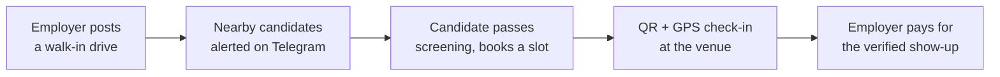
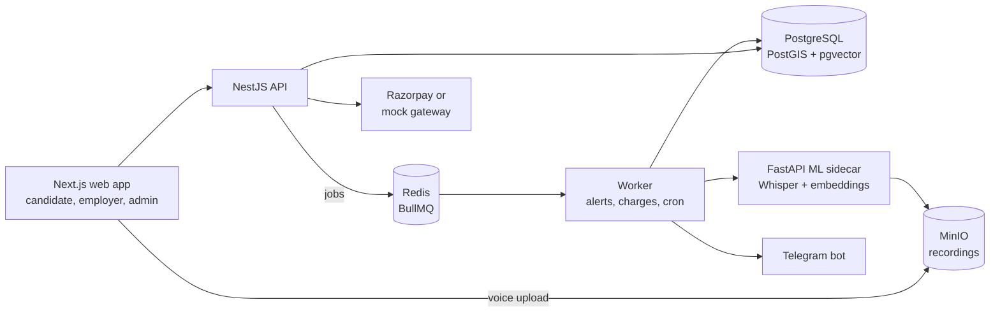

<h1 align="center">Walkins</h1>

<p align="center">
  <b>Walk-in hiring for India's frontline workforce.</b><br>
  Nearby candidates hear about hiring drives in time, book a slot, check in at the venue,<br>
  and employers pay only for people who actually show up.
</p>

<p align="center">
  
  
  
  
  
  
  
  
</p>

---

## The problem

Warehouses, retail chains, delivery fleets and BPOs fill frontline roles through **walk-in drives**: be at this address, on this day, between these hours. Three things go wrong:

| Who | What goes wrong today |
| --- | --- |
| **Candidates** | They hear about drives late or not at all, travel for jobs they never qualified for, and are targeted by fake recruiters who charge "registration fees". Many have no CV and are more at ease speaking than writing, often not in English. |
| **Employers** | They pay for postings and leads, not for people who walk through the door. No-shows are high and there is no reliable way to know who actually came. |
| **Both** | Coordination happens over phone calls and forwarded messages, so a rescheduled drive or a filled slot never reaches the people it affects. |

## The solution

Walkins is a full-stack platform built around the one moment that matters to both sides: **a verified person arriving at the venue.**



| For candidates | For employers |
| --- | --- |
| Alerts for drives within **their own** travel radius | Drives with time slots, seat limits and up to five pass/fail screening questions |
| Told up front if they miss a requirement, so they never travel for nothing | Applicants ranked by an adjustable mix of AI match score and distance |
| A 45-second **voice intro** in any language instead of a CV | Voice intros transcribed automatically, with the recording always one click away |
| Check-in that works even without mobile signal | A live arrivals board for the venue and a show-up funnel in analytics |
| A "never pay anyone" warning on every conversation | Team roles (owner, recruiter, viewer) and one shared inbox per company |

## Business model: pay per verified show-up

Applications, alerts and bookings are free. An employer pays a flat fee **only when a candidate's arrival is verified** (set at ₹200 in the seed data, stored as data so it can change without a release).

- **Aligned incentives.** The employer pays for the outcome they care about, not for impressions or leads.
- **Verifiable.** A rotating QR code at the desk plus a GPS check within 200 m of the venue proves the arrival. Loose GPS readings and late offline scans are flagged and charged only after the employer confirms them.
- **Prepaid wallet.** Employers top up a wallet (Razorpay test mode or a built-in mock gateway). A drive cannot go live without enough balance for one check-in.
- **Auditable money.** Every rupee moves through a double-entry ledger whose rules are enforced by PostgreSQL itself, and a sweep every 15 minutes re-queues any missed charge, so a charge can be delayed but never lost.

## Trust and safety

Fake recruiters charging fees are the biggest risk in this market, so trust is built in, not added later:

- **Company verification.** Owners submit GSTIN and documents; an admin approves before a company gets full reach.
- **Money-request tripwire.** Messages that look like a fee demand (UPI handles, bank details, fee wording in English, Hinglish and Hindi) are delivered with a visible warning, and every message can be reported.
- **Moderation.** Admins handle reports, warnings and suspensions. Notices tell affected candidates what is happening and what to do, without blaming them.
- **Privacy by default.** Voice recordings are deleted after 180 days or when replaced. The arrivals board facing the queue shows only first name and last initial.

---

## Architecture



| Part | Role |
| --- | --- |
| `apps/web` | Next.js 15, TypeScript, Tailwind and a MapLibre city map. Installable on phones, with offline check-in. |
| `apps/api` | NestJS REST API with phone OTP login, short-lived JWTs and rotating refresh tokens. |
| `apps/worker` | Alert fan-out, reminders, charging, transcription and embedding jobs, nightly maintenance, and the Telegram bot. |
| `services/ml` | Python FastAPI service running Whisper `small` for speech-to-text and a multilingual MiniLM model for 384-dimension embeddings. |
| `packages/db` | Prisma schema, migrations, geospatial targeting and the ledger. |
| `packages/shared` | Shared types, zod schemas and the single message catalog, ready for Hindi. |

## Engineering highlights

- **Geospatial targeting.** Each candidate sets their own travel radius, so the query for "who should hear about this drive" respects per-person distance, using PostGIS with a bounding-box prefilter.
- **AI matching across languages.** Candidates and drives are embedded with a multilingual model in pgvector, so a Hindi voice intro can match an English job post. Employers blend match score and distance with a slider.
- **Honest AI.** Whisper's Hindi error rate was measured on real voices (about 39% on one read script) and the interface was designed around that: every transcript is labelled as automatic, low-confidence text is folded behind the recording, and transcripts in a script the employer's team cannot read are not shown.
- **Exactly-once alerts and charges.** Database claims and unique indexes stop duplicate sends and double charges, even when jobs retry; failed jobs land in a dead-letter view admins can retry safely.
- **Built for real venues.** Check-in codes are short enough to type when a camera fails, scans made without signal are saved on the phone and sent later, and rescheduling a drive moves every booking with it.
- **Tested.** About 200 automated tests across the API, worker and web app.

## Status

A working prototype that runs end to end on one machine with no paid services or API keys. Still to come: company self sign-up, WhatsApp delivery (a stub pending Meta business verification), a Hindi interface, and refunds. The full list is in the [technical reference](docs/TECHNICAL.md).

## Run it locally

Requires Node.js 20+, pnpm 9+ and Docker.

```bash
cp .env.example .env
pnpm install
pnpm docker:up      # Postgres, Redis, MinIO and the ML sidecar
pnpm db:migrate
pnpm db:seed
pnpm dev            # web on :3000, API on :4000
```

The first start downloads about 590 MB of speech and embedding models. Alerts print to the console unless a Telegram bot token is set in `.env`.

## Documentation

The [technical reference](docs/TECHNICAL.md) covers every feature in depth: notification guarantees, check-in rules, the transcription measurements, the ledger, team permissions, rate limits, and setup details.
